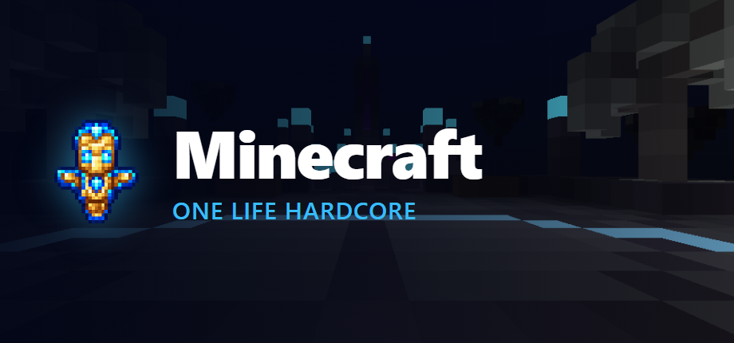

# IkBrian

**Founder & developer of [One Life Hardcore](https://github.com/One-Life-Hardcore)** 
Building Minecraft servers, plugins and the web platforms around them.

 

---

## 👨‍💻 About me

- 🏗️ I run and build **One Life Hardcore**, a hardcore Minecraft network where you only get one life
- ☕ I write **Java** plugins for Paper and Velocity, and full-stack **Node.js, React and TypeScript** for the web side
- 🖥️ I handle the whole stack myself: Linux servers, nginx, proxies, databases, Discord bots
- 🔭 Currently working on **Semi Hardcore**, our second server (launched November 2026): Blood Moons, raids and relics
- 🎮 And when I'm not building, I'm gaming

## 🚀 Featured project

<table>
<tr>
<td width="120" align="center">

</td>
<td>

### [One Life Hardcore](https://github.com/One-Life-Hardcore)
A real hardcore Minecraft SMP, where death actually matters: two survival servers, a Lobby queue and a proxy network, all running on custom software.

`38 custom plugins` · `1,600+ players` · `website, wiki and admin panel` · `Discord bot`

</td>
</tr>
</table>

## 🧰 Tech stack

**Languages** 

**Frameworks and platforms** 

**Infrastructure** 

## 🎮 Games I play

<table>
<tr>
<td align="center" colspan="3" width="50%">
 
<b>Minecraft</b> Sandbox · survival · I run my own server
</td>
<td align="center" colspan="3" width="50%">
 
<b>Call of Duty</b> FPS · 1,400+ hours
</td>
</tr>
<tr>
<td align="center" colspan="2" width="33%">
 
<b>The Outlast Trials</b> Co-op survival horror
</td>
<td align="center" colspan="2" width="33%">
 
<b>Sons of the Forest</b> Survival horror
</td>
<td align="center" colspan="2" width="33%">
 
<b>Resident Evil Village</b> Survival horror
</td>
</tr>
</table>

## 📫 Connect

| | |
| --- | --- |
|  **Discord** | `ikBrian` |
|  **Instagram** | [@IkBrian](https://instagram.com/IkBrian) |
|  **Steam** | [IkBrian](https://steamcommunity.com/id/IkBrian/) |
| 🌐 **Website** | [onelifehardcore.net](https://onelifehardcore.net) |
| 💬 **Community** | [One Life Hardcore Discord](https://discord.gg/xR55H8zGD4) |
